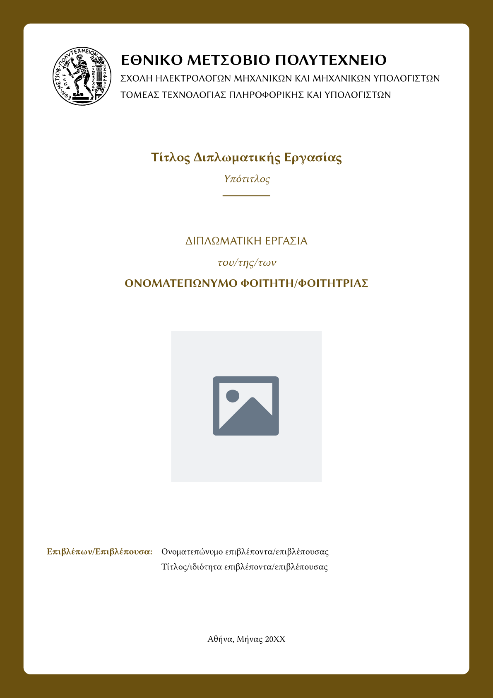

# ntua-thesis-greek

Diploma thesis template for the National Technical University of Athens (NTUA / ΕΜΠ), implemented as a [Typst](https://typst.app/) local package.

An independent student-created template, used for a
[completed NTUA diploma thesis](https://artemis.ece.ntua.gr/handle/123456789/20365).
This is not an official university template; check the submission requirements
of your school before submitting your document.



Supports three output modes:

- **Spiral binding**, a single PDF with the title page and back cover embedded
- **Paperback binding**, a body-only PDF plus a separate print-ready book cover spread (back cover, spine, front cover) with automatic spine width, bleed, and crop marks
- **Library submission**, a monochrome PDF without decorative cover elements

## Installation

Requires [just](https://github.com/casey/just) and [Typst](https://github.com/typst/typst). The paperback workflow additionally requires `pdfinfo` (from `poppler-utils`) to count pages for spine-width calculation.
Install Libertinus Serif and Libertinus Sans for the default typography.
Ioskeley Mono is bundled with its SIL Open Font License. Typst downloads the
imported preview packages on first use, so the initial build needs internet
access unless those packages are already cached.

Clone this repository and run the following commands from its root. The supplied
installation recipe uses `~/.local/share/typst/packages/local/`, the Linux local
package directory. On other systems, override `install_dir` with the appropriate
Typst local package location.

From the package root:

```bash
just install    # copy files to the typst local packages directory
just update     # alias for install (run after editing the package)
just uninstall  # remove the package
just status     # show what is currently installed
```

## Quick Start

Scaffold a new thesis project:

```bash
typst init @local/ntua-thesis-greek my-thesis
cd my-thesis
just spiral     # first compile
```

Your project has its own `justfile` with the compile recipes:

```bash
just spiral       # full PDF with embedded covers   -> dist/spiral/thesis-spiral.pdf
just paperback    # body + separate cover spread    -> dist/paperback/{thesis-body,thesis-cover}.pdf
just library      # library PDF -> dist/library/thesis.pdf
just all          # produce all three distributions
```

## Project Structure

```
my-thesis/
├── main.typ                    # Body entry point
├── config.typ                  # Shared parameters (main.typ + cover.typ)
├── cover.typ                   # Paperback book-cover spread
├── justfile                    # Build recipes (spiral / paperback / all)
├── front_matter/
│   ├── examination_committee.typ
│   ├── copyright.typ
│   ├── abstract.typ            # Περίληψη + Abstract
│   └── acknowledgements.typ    # Dedication + Ευχαριστίες
├── body_matter/
│   └── chap1.typ               # First chapter (add more as needed)
├── back_matter/
│   └── glossary.typ            # Glossary / acronym entries
├── assets/
│   └── figures/                # Your images
└── bibliography.bib            # BibTeX references
```

## Library submission and bibliography

The front matter starts the acknowledgements and table of contents on odd pages,
using `blank-pagebreak(to: "odd")` after the Abstract and acknowledgements.
For the default one-page sections, this leaves a blank verso without a running
header or page number. If either section spans multiple pages, check the PDF
and insert an explicit blank page if needed to meet your library's requirements.

The bibliography uses `template/citation_styles/ieee-library.csl`, an IEEE
adaptation matching the library's web-reference example. Its language is English
(US), while its title remains **Βιβλιογραφία**. Online entries include publication
dates when known and the actual access date. `template/bibliography.bib` contains
an example; see `template/citation_styles/README.md` for supported fields and
Typst import limitations. The CSL file retains its separate CC BY-SA 3.0 license.

After changing this template, run `just update` in the package directory.
Existing thesis projects keep their own `main.typ`, bibliography, and citation
style files; copy the corresponding changes into them as well. Build those
projects with their own `just all` or `just library` recipes.

## Configuration

All thesis parameters live in `config.typ` and are automatically shared between the body (`main.typ`) and the book cover (`cover.typ`). Edit once, applies to both.

```typst
// config.typ
#let config = (
    title: [Your Thesis Title],
    subtitle: [Subtitle],
    author: "Your Name",
    author_uppercase: "YOUR NAME",
    definite_article: "του", // "του" / "της" / "των"
    supervisor: "Supervisor Name",
    supervisor_title: "Καθηγητής Ε.Μ.Π.",
    // ... see template/config.typ for the full list
    accent_color: rgb("#003262"),
)
```

`main.typ` and `cover.typ` both pass `config` to their setup function via spread:

```typst
#show: thesis-setup.with(..config)   // main.typ
#show: cover-wrap.with(..config, …)  // cover.typ
```

## Adding Chapters

Create a new file in `body_matter/` and include it from `main.typ`:

```typst
// body_matter/chap2.typ
#import "@local/ntua-thesis-greek:0.1.0": *

= My Chapter Title

#histinit[
    Opening paragraph with a decorative drop cap...
]

== Section

Content.
```

```typst
// main.typ
#include "body_matter/chap2.typ"
```

Use `#part[...]` to group chapters into logical parts (rendered on their own divider pages).

## Features

### Color Propagation

Set `accent_color` and optionally `secondary_color` once, and they propagate to headings, links, citations, captions, outline entries, figure supplements, drop caps, and the back-cover decorations:

```typst
accent_color: rgb("#8B0000"),
secondary_color: none,   // defaults to accent_color.darken(20%)
```

### Figures and Tables

Chapter-relative numbering is applied automatically (e.g. `Σχήμα 2.3`, `Πίνακας 2.1`). Tables follow the IEEE three-rule style with bold headers and caption-on-top.

```typst
#figure(
    image("assets/figures/my-image.svg", width: 80%),
    caption: [Description of the figure.],
) <fig-my-image>

#figure(
    table(
        columns: 3,
        table.header[*Col 1*][*Col 2*][*Col 3*],
        [A], [B], [C],
    ),
    kind: table,
    caption: [Description of the table.],
) <tbl-my-table>
```

### Code Listings

Formatted via [codly](https://typst.app/universe/package/codly) with an accent-colored side bar, language icons, and zebra striping:

```typst
#code-figure(
    caption: [My code example.],
    label: <code-example>,
    ```python
    def hello():
        print("Hello, world!")
    ```,
)
```

`font-size` sets the size of the listing alone, leaving the caption at body size. It is useful for a listing with long lines that would otherwise overflow the frame. Relative lengths are taken against the surrounding text, so `0.9em` is 90% of the body size:

```typst
#code-figure(
    caption: [A listing with long lines.],
    font-size: 0.9em,
    ```rust
    let very_long_identifier = some_function_with_a_long_name(argument_one, argument_two);
    ```,
)
```

Pass `extra_syntaxes` / `extra_languages` to `thesis-setup` to add custom languages (e.g. Move, Solidity).

### Algorithms (Pseudocode)

Powered by the [algorithmic](https://typst.app/universe/package/algorithmic) package:

```typst
#algorithm-figure(
    caption: [Binary search.],
    label: <alg-bsearch>,
    title: [Binary Search],
    input: [sorted array $A$, target $t$],
    output: [index of $t$ or $-1$],
    (
        Function("BSearch", ($A$, $t$), {
            // ...
        }),
    ),
)
```

### Theorem-like Environments (IEEE style)

```typst
#theorem(name: "Pythagoras")[$a^2 + b^2 = c^2$.]
#lemma[...]
#corollary[...]
#proposition[...]
#definition[...]
#remark[...]
#example[...]
#proof[...]
```

### Equations

Chapter-relative numbering like `(2.1)`:

```typst
$ E = m c^2 $ <eq-energy>
```

### Glossary and Acronyms

Define entries in `back_matter/glossary.typ`, then reference with glossarium helpers:

```typst
#gls("key")      // short form
#glspl("key")    // plural
#Gls("key")      // capitalized
#Glspl("key")    // capitalized plural
```

### Short Captions

Captions under figures and tables are usually several sentences long and carry citations. The lists of figures and tables want a plain title instead. Citations are dropped from those lists automatically; for the text itself use `#short-caption`, the equivalent of LaTeX's `\caption[short]{long}`:

```typst
#figure(
    image("../assets/figures/red-stuff.svg"),
    caption: short-caption([Η δισδιάστατη κωδικοποίηση Red Stuff])[
        Η δισδιάστατη κωδικοποίηση Red Stuff. Το ίδιο σύμβολο ανήκει ταυτόχρονα στο
        πρωτεύον sliver του ενός κόμβου και στο δευτερεύον sliver του άλλου @source.
    ],
)<fig-red-stuff>
```

The first argument goes to the list of figures, the second one under the figure. Without `#short-caption` the whole caption is listed, minus its citations.

### Other Helpers

```typst
#numless[= Unnumbered Heading]
#part[Θεωρητικό Μέρος]
#dedication("To my family")
#accent-box[Highlighted note with accent side bar and subtle fill.]
```

### Back Cover (spiral mode)

The final back cover is rendered automatically at the end of `main.typ`. It picks up the Greek `#perilipsi` (abstract) as its inside text and optionally adds a QR code and ISBN barcode:

```typst
#back-cover(
    github_url: "https://github.com/user/repo",
    isbn: "978-960-12-3456-4",
)
```

### Book Cover Spread (paperback mode)

`cover.typ` produces a single-page canvas containing the back cover, spine, and front cover, with auto-calculated spine width, 3 mm bleed, and crop marks for professional printing. Spine thickness is derived from the body PDF's page count; `just paperback` wires this up automatically.

## Parameters

Thesis setup (`thesis-setup` / `config.typ`):

| Parameter | Description | Default |
|-----------|-------------|---------|
| `title` | Thesis title (content) | placeholder |
| `subtitle` | Thesis subtitle (content) | placeholder |
| `logo` | Logo image content shown on the title page | `none` |
| `division` | Department/division name | Τομέας Τεχνολογίας Πληροφορικής… |
| `author` | Author name (mixed case) | placeholder |
| `author_uppercase` | Author name (all caps, for the title page) | placeholder |
| `definite_article` | Grammatical article ("του" / "της" / "των") | `"του/της/των"` |
| `supervisor_text` | Supervisor label | `"Επιβλέπων"` |
| `supervisor` | Supervisor name | placeholder |
| `supervisor_title` | Supervisor academic title | placeholder |
| `co_supervisor_text` | Co-supervisor label (empty hides the block) | `""` |
| `co_supervisor` | Co-supervisor name | `""` |
| `co_supervisor_title` | Co-supervisor academic title | `""` |
| `examination_date` | Examination date | placeholder |
| `first_examiner` / `_title` | First examiner name and title | placeholder |
| `second_examiner` / `_title` | Second examiner name and title | placeholder |
| `third_examiner` / `_title` | Third examiner name and title | placeholder |
| `pub_place_date` | Publication place and date | placeholder |
| `copyright_year` | Copyright year | placeholder |
| `accent_color` | Primary accent color | `rgb("#003262")` |
| `secondary_color` | Secondary color | `accent_color.darken(20%)` if `none` |
| `serif_font` | Main body / math font | `"Libertinus Serif"` |
| `sans_font` | Headings and cover font | `"Libertinus Sans"` |
| `code_font` | Monospace / pseudocode font | `"New Computer Modern Mono"` |
| `font_size` | Base font size | `11pt` |
| `paper` | Paper size (`"a4"`, `"us-letter"`, …) | `"a4"` |
| `margin_top` / `margin_bottom` | Vertical page margins | `2.5cm` |
| `margin_inside` | Inside (binding) margin | `3.5cm` |
| `margin_outside` | Outside margin | `2.5cm` |
| `extra_syntaxes` | Additional syntax files for `raw` (codly) | `()` |
| `extra_languages` | Additional codly language definitions | `(:)` |
| `include_covers` | Embed title page and back cover (`false` for paperback body) | `true` |

Book cover (`cover-wrap`, in addition to the shared config):

| Parameter | Description | Default |
|-----------|-------------|---------|
| `content` | Abstract text printed inside the back cover | `none` |
| `content_gap` | Drop-cap gap for the back-cover text | `3pt` |
| `github_url` | If set, renders a white QR code bottom-left | `none` |
| `isbn` | If set, renders an EAN-13 barcode bottom-right | `none` |
| `spine_title_font_size` | Spine title size (auto-fits if `auto`) | `auto` |
| `spine_label_font_size` | Spine "ΔΙΠΛΩΜΑΤΙΚΗ ΕΡΓΑΣΙΑ" label size | `auto` |
| `page_count` | Body page count (for spine width) | `200` |
| `paper_thickness_per_page` | Per-page paper thickness | `0.1mm` |
| `spine_safe_margin` | Spine content safe-area margin | `2mm` |

## License

The template source uses the [MIT license](LICENSE). Fonts, the citation style,
and organizational marks have separate notices in [THIRD_PARTY.md](THIRD_PARTY.md).
